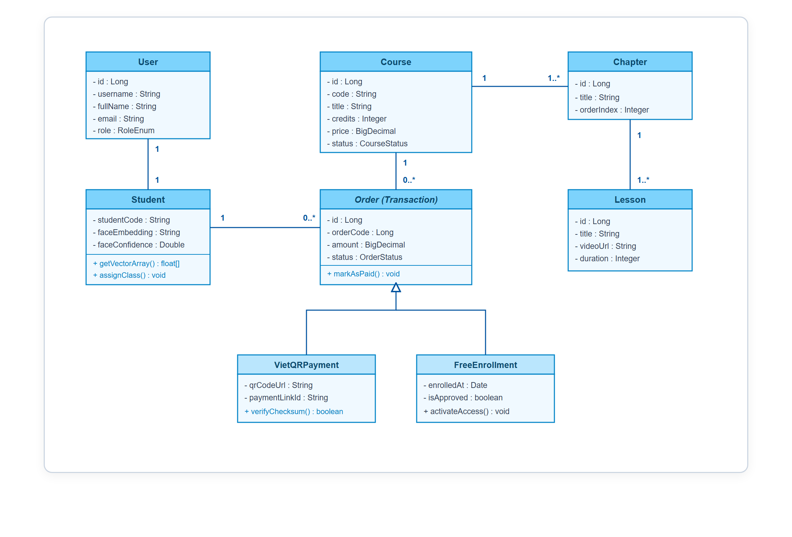
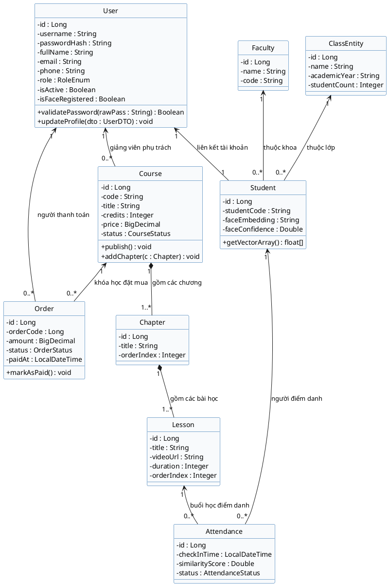
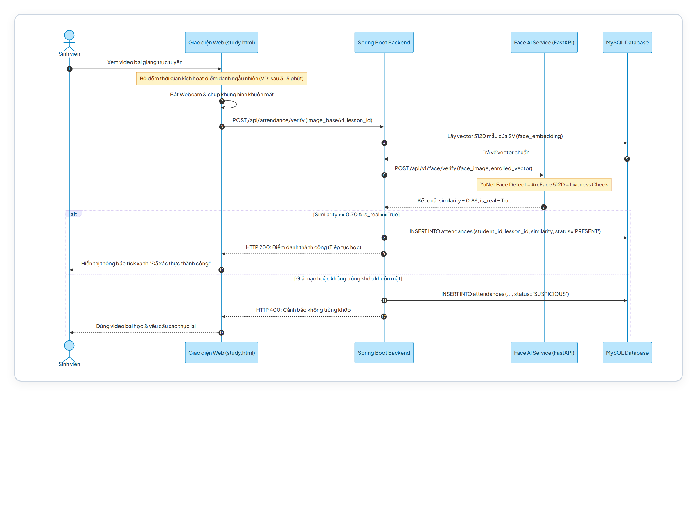
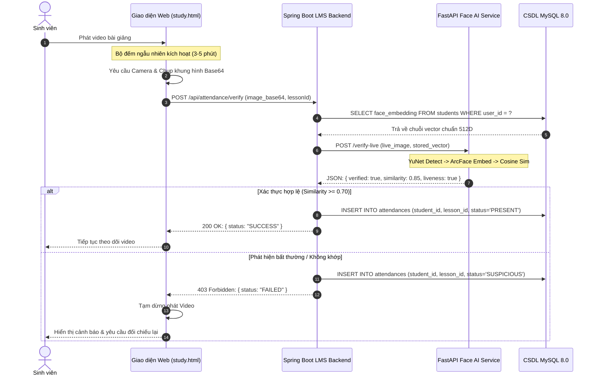
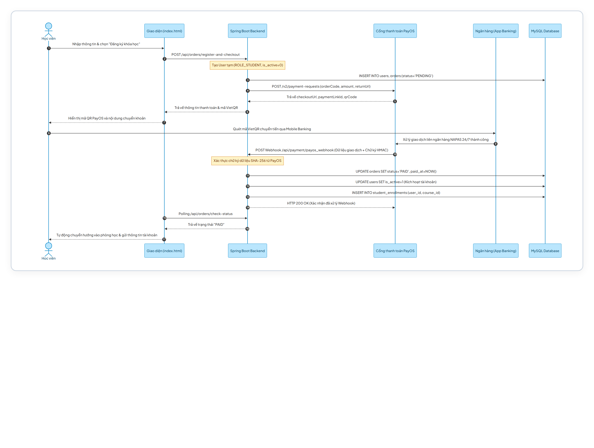
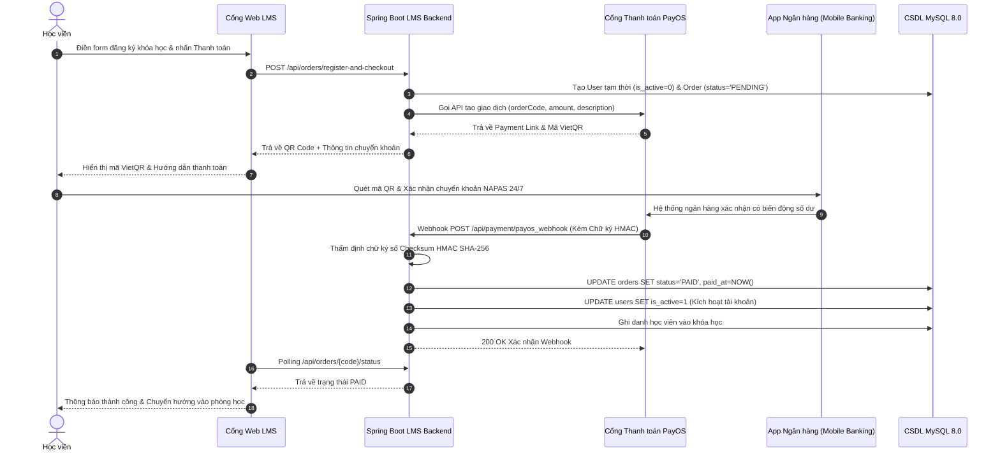
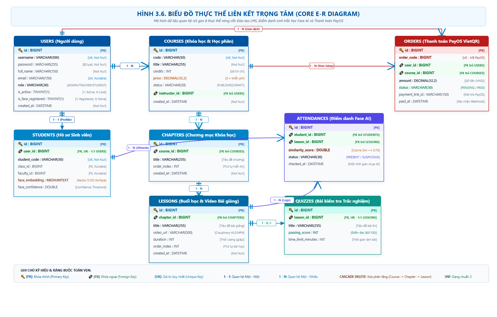

# TÀI LIỆU BÁO CÁO ĐỒ ÁN TỐT NGHIỆP
## CHƯƠNG 3: THIẾT KẾ HỆ THỐNG VÀ CƠ SỞ DỮ LIỆU
### (Từ Mục 3.3 Thiết kế lớp đến hết Chương 3)

---

## 3.3. THIẾT KẾ LỚP

Hệ thống quản lý học tập trực tuyến thông minh EduFace được thiết kế theo nguyên tắc lập trình hướng đối tượng (Object-Oriented Programming - OOP) kết hợp với mô hình kiến trúc phân tầng đa lớp (**Multi-tier Architecture**). Các lớp trong hệ thống được phân định rõ ràng giữa:
- **Tầng điều khiển (Controller Layer)**: Tiếp nhận các yêu cầu HTTP/RESTful API từ phía trình duyệt Web và ứng dụng di động, thẩm định tham số đầu vào (Validation) và điều hướng luồng xử lý.
- **Tầng xử lý nghiệp vụ (Service Layer)**: Hiện thực hóa toàn bộ các quy tắc nghiệp vụ đào tạo, thuật toán tính điểm chuyên cần, điều phối xác thực sinh trắc học khuôn mặt và xử lý giao dịch tài chính.
- **Tầng truy xuất cơ sở dữ liệu (Repository / DAO Layer)**: Sử dụng Spring Data JPA / Hibernate để tương tác hướng đối tượng với hệ quản trị cơ sở dữ liệu quan hệ MySQL 8.0.

Trong đó, các lớp thực thể miền (**Domain Entities**) đóng vai trò nòng cốt, đại diện cho các đối tượng nghiệp vụ đào tạo đại học, quản lý thông tin sinh trắc học và các giao dịch tài chính, đảm bảo tính toàn vẹn và bảo mật dữ liệu cao.

---

### 3.3.1. Thiết kế chi tiết các lớp chủ đạo

Dưới đây là đặc tả chi tiết về cấu trúc thuộc tính và phương thức nghiệp vụ của 4 lớp chủ đạo quan trọng nhất cấu thành hệ sinh thái học tập EduFace, bao gồm:
1. **Lớp User**: Quản lý tài khoản người dùng, phân quyền bảo mật Spring Security và trạng thái hoạt động.
2. **Lớp Student**: Quản lý hồ sơ sinh viên, thông tin lớp - khoa và dữ liệu sinh trắc học vector 512 chiều ArcFace.
3. **Lớp Course**: Quản trị học phần đào tạo, đề cương chương mục và chính sách học phí.
4. **Lớp Lesson**: Quản lý nội dung bài giảng video, liên kết tài liệu Cloudinary và tiến trình học tập của sinh viên.

---

#### Bảng 3.1. Lớp User

| Phương thức | Thuộc tính |
| :--- | :--- |
| `+ validatePassword(rawPass: String): Boolean`<br>`+ updateProfile(fullName, email, phone): void`<br>`+ updateAvatar(avatarUrl: String): void`<br>`+ changePassword(newPasswordHash: String): void`<br>`+ lockAccount(): void`<br>`+ unlockAccount(): void`<br>`+ hasRole(requiredRole: Role): Boolean`<br>`+ getAuthorities(): Collection<? extends GrantedAuthority>`<br>`+ isEnabled(): boolean` | `- id: Long`<br>`- username: String`<br>`- email: String`<br>`- phone: String`<br>`- passwordHash: String`<br>`- fullName: String`<br>`- avatarUrl: String`<br>`- role: RoleEnum`<br>`- status: UserStatus`<br>`- isFaceRegistered: Boolean`<br>`- createdAt: LocalDateTime`<br>`- updatedAt: LocalDateTime` |

*Ghi chú*: Lớp `User` hiện thực giao diện `UserDetails` của Spring Security Core, phục vụ công tác xác thực dựa trên JWT (JSON Web Token) và kiểm soát truy cập dựa trên vai trò (RBAC - Role-Based Access Control) gồm `ROLE_ADMIN`, `ROLE_TEACHER`, và `ROLE_STUDENT`.

---

#### Bảng 3.2. Lớp Student

| Phương thức | Thuộc tính |
| :--- | :--- |
| `+ registerFaceProfile(vector512D: String, imgUrl: String): void`<br>`+ updateFaceVector(newVector: String): void`<br>`+ verifyFace(inputVector: String, threshold: Double): Boolean`<br>`+ getDecryptedVector(): float[]`<br>`+ assignClass(classId: Long, facultyId: Long): void`<br>`+ updateStudentInfo(studentCode: String, dob: LocalDate): void`<br>`+ hasFaceRegistered(): Boolean` | `- id: Long`<br>`- user: User`<br>`- studentCode: String`<br>`- classId: Long`<br>`- facultyId: Long`<br>`- majorId: Long`<br>`- dateOfBirth: LocalDate`<br>`- gender: Gender`<br>`- faceEmbedding: String (Vector 512D)`<br>`- faceConfidence: Double`<br>`- faceRegisteredAt: LocalDateTime`<br>`- createdAt: LocalDateTime` |

*Ghi chú*: Trường `faceEmbedding` lưu trữ chuỗi vector 512 chiều trích xuất từ mạng nơ-ron sâu ArcFace MobileFaceNet, được dùng làm mẫu chuẩn (*Ground Truth*) để so khớp Cosine Similarity khi sinh viên tham gia học và làm bài kiểm tra.

---

#### Bảng 3.3. Lớp Course

| Phương thức | Thuộc tính |
| :--- | :--- |
| `+ calculateOverallProgress(studentId: Long): Double`<br>`+ isEligibleForEnrollment(studentMajor: Long): Boolean`<br>`+ publishCourse(): void`<br>`+ archiveCourse(): void`<br>`+ updatePricing(price: BigDecimal, isFree: Boolean): void`<br>`+ getCurriculumChapters(): List<CourseChapter>`<br>`+ getTotalDuration(): Integer`<br>`+ addChapter(chapter: CourseChapter): void` | `- id: Long`<br>`- code: String`<br>`- title: String`<br>`- description: String`<br>`- thumbnailUrl: String`<br>`- credits: Integer`<br>`- price: BigDecimal`<br>`- isFree: Boolean`<br>`- status: CourseStatus`<br>`- instructor: User`<br>`- createdAt: LocalDateTime`<br>`- updatedAt: LocalDateTime` |

*Ghi chú*: Lớp `Course` đại diện cho một học phần trong chương trình đào tạo. Nếu `isFree = true`, học viên có thể ghi danh trực tiếp; nếu `isFree = false`, học viên sẽ thực hiện quy trình thanh toán PayOS VietQR trước khi được mở quyền truy cập tài liệu và bài giảng.

---

#### Bảng 3.4. Lớp Lesson

| Phương thức | Thuộc tính |
| :--- | :--- |
| `+ trackStudyHeartbeat(studentId: Long, curSeconds: Integer): void`<br>`+ markAsCompleted(studentId: Long): Boolean`<br>`+ getVideoHlsStreamUrl(): String`<br>`+ checkAttendanceRequired(): Boolean`<br>`+ isSequentialUnlock(studentId: Long): Boolean`<br>`+ updateOrderIndex(newIndex: Integer): void` | `- id: Long`<br>`- chapter: CourseChapter`<br>`- title: String`<br>`- videoUrl: String`<br>`- duration: Integer (Seconds)`<br>`- orderIndex: Integer`<br>`- isQuizRequired: Boolean`<br>`- createdAt: LocalDateTime`<br>`- updatedAt: LocalDateTime` |

*Ghi chú*: Phương thức `trackStudyHeartbeat` ghi nhận nhịp phát video của sinh viên mỗi 15-30 giây, kết hợp với bộ kích hoạt điểm danh sinh trắc học ngẫu nhiên để đảm bảo tính trung thực học tập.

---

### 3.3.2. Sơ đồ lớp (Class Diagram)

Sơ đồ lớp (**UML Class Diagram**) mô tả khái quát cấu trúc tĩnh của toàn bộ hệ sinh thái EduFace, xác định các lớp nghiệp vụ chính, các thuộc tính, phương thức và mối liên kết ngữ nghĩa giữa chúng. Sơ đồ làm rõ cách thức phân quyền người dùng, quan hệ bao hàm giữa khóa học và bài giảng, cũng như cơ chế gắn kết giữa tài khoản học viên với hồ sơ sinh trắc học và lịch sử giao dịch thanh toán:



**Hình 3.5. Sơ đồ lớp chủ đạo (UML Class Diagram)**

#### Phân tích các mối quan hệ ngữ nghĩa trên biểu đồ lớp:
1. **Mối quan hệ giữa User và Student (Quan hệ 1 - 1)**:
   - Mỗi đối tượng `User` có vai trò `ROLE_STUDENT` sẽ liên kết duy nhất với một thực thể `Student`.
   - Thực thể `Student` mở rộng thông tin đào tạo (mã số sinh viên `studentCode`, lớp sinh hoạt, khoa) và dữ liệu sinh trắc học khuôn mặt ArcFace (`faceEmbedding`, `faceConfidence`).
2. **Mối quan hệ cấu trúc học phần (Course - Chapter - Lesson) (Quan hệ Composition - Hợp thành mạnh)**:
   - Một khóa học (`Course`) bao gồm một hoặc nhiều chương mục (`Chapter 1..*`), và mỗi chương mục gồm một hoặc nhiều bài học (`Lesson 1..*`).
   - Mối quan hệ được cấu hình ràng buộc `CASCADE ALL` và `orphanRemoval = true`: Khi một khóa học bị xóa, toàn bộ các chương và bài giảng trực thuộc sẽ bị giải phóng tương ứng, bảo đảm tính toàn vẹn tham chiếu.
3. **Mối quan hệ điểm danh sinh trắc học (Student - Attendance - Lesson) (Quan hệ Aggregation - Kết tập)**:
   - Trong quá trình theo dõi bài giảng video, thực thể `Attendance` ghi nhận sự hiện diện thực tế của `Student` đối với một `Lesson` cụ thể.
   - Bản ghi lưu trữ điểm số tương đồng Cosine Similarity (`similarityScore`) và trạng thái có mặt (`PRESENT` / `SUSPICIOUS`).
4. **Mối quan hệ giao dịch đơn hàng (User - Order - Course) (Quan hệ Phụ thuộc nghiệp vụ)**:
   - Một người dùng (`User`) có thể tạo nhiều đơn hàng (`Order`) để đặt mua các khóa học có phí (`Course`).
   - Thực thể `Order` lưu trữ mã giao dịch tích hợp với cổng PayOS (`orderCode`), số tiền thanh toán (`amount`), trạng thái (`PENDING`, `PAID`, `CANCELLED`) và mốc thời gian ngân hàng xác nhận giao dịch thành công (`paidAt`).



---

### 3.3.3. Thiết kế luồng truyền thông điệp (Sequence Diagram)

Biểu đồ trình tự (**Sequence Diagram**) minh họa sự tương tác động và luồng trao đổi thông điệp theo trục thời gian giữa người dùng, trình duyệt Web, backend Spring Boot, dịch vụ Face AI chuyên trách, cổng thanh toán PayOS và cơ sở dữ liệu. Dưới đây là đặc tả chi tiết hai ca sử dụng trọng tâm nhất của hệ thống:

---

#### 3.3.3.1. Luồng xác thực điểm danh sinh trắc học Face AI ngẫu nhiên

Trong suốt thời gian sinh viên học bài qua video, hệ thống ngẫu nhiên kích hoạt camera sau mỗi khoảng thời gian định trước (3 - 5 phút) để chụp khung hình khuôn mặt, gửi về phân hệ Face AI kiểm tra độ sống (Anti-spoofing) và so khớp vector 512D với dữ liệu đã nạp khi đăng ký tài khoản. Biểu đồ trình tự được thể hiện tại Hình 3.5a:



**Hình 3.5a. Biểu đồ trình tự Xác thực điểm danh sinh trắc học Face AI**

##### Luồng xử lý chi tiết qua 9 bước tuần tự:
- **Bước 1**: Sinh viên truy cập phòng học trực tuyến (`study.html`) và bắt đầu phát video bài giảng.
- **Bước 2**: Bộ đếm thời gian ngẫu nhiên (*Randomized Heartbeat Timer*) trên trình duyệt tự động kích hoạt sau khoảng thời gian ngẫu nhiên từ 3 đến 5 phút để chống gian lận dùng ảnh tĩnh định kỳ.
- **Bước 3**: Trình duyệt yêu cầu luồng WebRTC từ Camera/Webcam của thiết bị, thực hiện chụp một khung hình chất lượng cao và mã hóa sang định dạng chuỗi Base64.
- **Bước 4**: Giao diện gửi yêu cầu `POST /api/attendance/verify` kèm dữ liệu ảnh Base64, mã bài học `lessonId` và mã phiên học về Spring Boot Backend.
- **Bước 5**: Spring Boot Backend truy vấn cơ sở dữ liệu MySQL để trích xuất chuỗi vector 512D chuẩn (`face_embedding`) của sinh viên từ bảng `students`.
- **Bước 6**: Backend thực hiện cuộc gọi RESTful API nội bộ sang phân hệ **FastAPI Face AI Service** (cổng 8000) với tham số là ảnh chụp hiện tại và vector mẫu đã lưu.
- **Bước 7**: Dịch vụ Face AI thực hiện chuỗi xử lý mạng nơ-ron sâu:
  1. Dùng mô hình **YuNet** để phát hiện tọa độ và 5 điểm mốc khuôn mặt (Landmarks: 2 mắt, mũi, 2 khóe miệng).
  2. Áp dụng thuật toán kiểm tra độ sống sinh trắc học (**Liveness Check / Anti-spoofing**) nhằm ngăn chặn gian lận bằng ảnh in hoặc video phát lại từ màn hình khác.
  3. Cắt chỉnh khuôn mặt chuẩn và đưa qua mạng nơ-ron **ArcFace MobileFaceNet** trích xuất vector đặc trưng 512 chiều mới.
  4. Tính toán độ tương đồng Cosine Similarity giữa hai vector:
     $$\text{Similarity} = \frac{\mathbf{u} \cdot \mathbf{v}}{\|\mathbf{u}\| \|\mathbf{v}\|}$$
- **Bước 8**: Dịch vụ Face AI trả về kết quả đối chiếu. Nếu `similarity >= 0.70` và cờ kiểm tra thực thể sống hợp lệ:
  - Spring Boot Backend ghi nhận một bản ghi điểm danh với trạng thái `PRESENT` vào bảng `attendances`.
  - Phản hồi mã thành công về trình duyệt để sinh viên tiếp tục theo dõi video bài giảng bình thường.
- **Bước 9**: Trường hợp phát hiện dấu hiệu giả mạo màn hình hoặc độ tương đồng dưới ngưỡng (`similarity < 0.70`):
  - Backend ghi nhận trạng thái `SUSPICIOUS` vào cơ sở dữ liệu để phục vụ thanh tra.
  - Trình duyệt tự động tạm dừng phát video bài giảng (`video.pause()`) và hiển thị thông báo cảnh báo yêu cầu sinh viên nhìn thẳng vào camera để thực hiện xác thực lại.



---

#### 3.3.3.2. Luồng đăng ký khóa học và thanh toán trực tuyến PayOS VietQR

Khi học viên chọn khóa học có thu phí, hệ thống hỗ trợ đăng ký tài khoản nhanh và thanh toán trực tuyến qua cổng PayOS VietQR chuẩn liên ngân hàng NAPAS 24/7. Toàn bộ chu trình từ đăng ký thông tin, quét mã QR đến xác thực giao dịch qua Webhook được thể hiện tại Hình 3.5b:



**Hình 3.5b. Biểu đồ trình tự Đăng ký khóa học và Thanh toán PayOS VietQR**

##### Luồng xử lý chi tiết qua 9 bước tuần tự:
- **Bước 1**: Khách hàng/học viên truy cập cổng thông tin khóa học, chọn một khóa học có phí và điền thông tin cá nhân (Họ tên, Email, Số điện thoại) vào biểu mẫu ghi danh nhanh.
- **Bước 2**: Trình duyệt gửi yêu cầu `POST /api/orders/register-and-checkout` về Spring Boot Backend kèm thông tin người đăng ký và mã khóa học `courseId`.
- **Bước 3**: Backend kiểm tra cơ sở dữ liệu:
  - Nếu tài khoản chưa tồn tại: Tự động khởi tạo một tài khoản người dùng mới với vai trò `ROLE_STUDENT` và trạng thái `is_active = 0` (tạm khóa/chưa kích hoạt).
  - Khởi tạo một bản ghi đơn hàng trong bảng `orders` với trạng thái ban đầu là `PENDING`.
- **Bước 4**: Backend tương tác với Open API của Cổng thanh toán quốc gia PayOS, gửi yêu cầu tạo link thanh toán (`createPaymentLink`) chứa:
  - Mã đơn hàng số nguyên duy nhất (`orderCode`).
  - Số tiền học phí cần thu (`amount`).
  - Nội dung chuyển khoản theo cú pháp định danh (`description`).
  - Địa chỉ Webhook nhận thông báo tự động.
- **Bước 5**: Cổng thanh toán PayOS xử lý và trả về đối tượng dữ liệu chứa đường dẫn thanh toán an toàn (`checkoutUrl`) và mã VietQR chuẩn quốc gia.
- **Bước 6**: Giao diện hiển thị trực tiếp khung thanh toán thông minh:
  - Mã QR VietQR chuẩn NAPAS 24/7 để quét nhanh.
  - Thông tin chuyển khoản chi tiết: Số tài khoản ngân hàng thụ hưởng, Tên chủ tài khoản, Số tiền chính xác và Nội dung chuyển khoản.
  - Giao diện đồng thời kích hoạt cơ chế Long-Polling kiểm tra trạng thái đơn hàng định kỳ mỗi 2 giây.
- **Bước 7**: Học viên mở ứng dụng Ngân hàng số (Mobile Banking) hoặc Ví điện tử bất kỳ, quét mã VietQR và xác nhận lệnh chuyển tiền.
- **Bước 8**: Ngay khi hệ thống liên ngân hàng NAPAS báo có biến động số dư, Cổng PayOS phát tín hiệu Webhook tức thì `POST /api/payment/payos_webhook` kèm chữ ký bảo mật HMAC SHA-256 về backend hệ thống LMS.
- **Bước 9**: Backend thực hiện quy trình hoàn tất giao dịch khép kín:
  - Thẩm tra chữ ký số HMAC SHA-256 bằng khóa bảo mật bí mật (*Checksum Key*), đảm bảo thông điệp không bị giả mạo.
  - Cập nhật trạng thái đơn hàng sang `PAID` và ghi nhận mốc thời gian hoàn tất `paid_at`.
  - Tự động kích hoạt tài khoản học viên (`is_active = 1`).
  - Ghi danh học viên vào bảng theo dõi khóa học để mở khóa toàn bộ quyền hạn truy cập bài giảng và tài liệu PDF.
  - Giao diện Web nhận được tín hiệu thành công, tự động chuyển hướng học viên vào giao diện phòng học.



---

## 3.4. THIẾT KẾ CƠ SỞ DỮ LIỆU

Cơ sở dữ liệu của hệ thống EduFace được thiết kế theo mô hình quan hệ (**Relational Database Management System - RDBMS**) và triển khai trên hệ quản trị **MySQL phiên bản 8.0** với bộ mã ký tự `utf8mb4` và bảng mã đối chiếu `utf8mb4_unicode_ci` nhằm hỗ trợ lưu trữ toàn vẹn tiếng Việt có dấu, ký hiệu toán học và các ký tự đặc biệt.

Mô hình dữ liệu được chuẩn hóa nghiêm ngặt đạt **Dạng chuẩn 3 (3NF)**:
- Loại bỏ toàn bộ các phụ thuộc bắc cầu và lặp nhóm dữ liệu.
- Thiết lập đầy đủ các ràng buộc toàn vẹn khóa chính (**Primary Key - PK**), khóa ngoại tham chiếu (**Foreign Key - FK**) và giá trị duy nhất (**Unique Key - UK**).
- Tích hợp các chỉ mục cây tìm kiếm cân bằng (**B-Tree Indexes**) trên các trường có tần suất lọc và kết nối dữ liệu cao (`user_id`, `student_code`, `order_code`, `lesson_id`) nhằm tối ưu hóa hiệu năng truy vấn dưới 10ms đối với cơ sở dữ liệu hàng trăm nghìn bản ghi.

---

### 3.4.1. Danh sách bảng dữ liệu (Data Dictionary)

Dưới đây là từ điển dữ liệu chi tiết cho 8 bảng dữ liệu cốt lõi cấu thành cơ sở dữ liệu `lms_online_db` của hệ thống:

---

#### Bảng 3.5. Bảng `users` (Tài khoản người dùng & phân quyền)

Bảng quản lý tài khoản xác thực cho toàn bộ người dùng trong hệ thống (Quản trị viên, Giảng viên và Sinh viên/Học viên):

| Tên trường | Kiểu dữ liệu | Khóa | Null | Mô tả |
| :--- | :--- | :---: | :---: | :--- |
| `id` | `BIGINT` | **PK** | No | Khóa chính tự tăng của bảng người dùng |
| `username` | `VARCHAR(100)` | **UK** | No | Tên tài khoản đăng nhập (Email hoặc Mã sinh viên) |
| `password` | `VARCHAR(255)` | - | No | Mật khẩu đã mã hóa bằng thuật toán BCrypt Hash độ mạnh 10 |
| `full_name` | `VARCHAR(150)` | - | No | Họ và tên đầy đủ của người dùng |
| `email` | `VARCHAR(150)` | **UK** | Yes | Địa chỉ hòm thư điện tử cá nhân để nhận thông báo |
| `phone` | `VARCHAR(20)` | - | Yes | Số điện thoại liên lạc |
| `role` | `VARCHAR(30)` | - | No | Vai trò phân quyền: `ROLE_ADMIN`, `ROLE_TEACHER`, `ROLE_STUDENT` |
| `is_active` | `TINYINT(1)` | - | No | Trạng thái tài khoản (1: Đang kích hoạt, 0: Tạm khóa/Chờ thanh toán) |
| `is_face_registered` | `TINYINT(1)` | - | No | Trạng thái đăng ký Face ID (1: Đã nạp mẫu, 0: Chưa nạp) |
| `created_at` | `DATETIME` | - | No | Mốc thời gian khởi tạo tài khoản trong hệ thống |

---

#### Bảng 3.6. Bảng `students` (Hồ sơ sinh viên & Dữ liệu khuôn mặt)

Bảng lưu trữ thông tin học vụ mở rộng của sinh viên và chuỗi đặc trưng sinh trắc học ArcFace phục vụ điểm danh AI:

| Tên trường | Kiểu dữ liệu | Khóa | Null | Mô tả |
| :--- | :--- | :---: | :---: | :--- |
| `id` | `BIGINT` | **PK** | No | Khóa chính tự tăng hồ sơ sinh viên |
| `user_id` | `BIGINT` | **FK, UK** | No | Khóa ngoại duy nhất tham chiếu tới `users(id)` (Quan hệ 1-1) |
| `student_code` | `VARCHAR(50)` | **UK** | No | Mã số sinh viên chính thức (Ví dụ: `2310900051`) |
| `class_id` | `BIGINT` | **FK** | Yes | Khóa ngoại trỏ đến lớp sinh hoạt đào tạo `classes(id)` |
| `faculty_id` | `BIGINT` | **FK** | Yes | Khóa ngoại trỏ đến khoa quản lý chuyên môn `faculties(id)` |
| `dob` | `DATE` | - | Yes | Ngày tháng năm sinh của sinh viên |
| `face_embedding` | `MEDIUMTEXT` | - | Yes | Chuỗi lưu trữ vector đặc trưng khuôn mặt 512 chiều ArcFace |
| `face_confidence` | `DOUBLE` | - | Yes | Điểm số tin cậy khuôn mặt tại thời điểm đối chiếu đăng ký |

---

#### Bảng 3.7. Bảng `courses` (Khóa học và Học phần)

Bảng quản lý danh mục các khóa học trực tuyến, số tín chỉ và chính sách học phí:

| Tên trường | Kiểu dữ liệu | Khóa | Null | Mô tả |
| :--- | :--- | :---: | :---: | :--- |
| `id` | `BIGINT` | **PK** | No | Khóa chính định danh khóa học |
| `code` | `VARCHAR(50)` | **UK** | No | Mã học phần hoặc mã định danh khóa học (Ví dụ: `CS301`) |
| `title` | `VARCHAR(255)` | - | No | Tên gọi đầy đủ của khóa học / học phần |
| `description` | `TEXT` | - | Yes | Nội dung tóm tắt đề cương chi tiết môn học |
| `credits` | `INT` | - | No | Số lượng tín chỉ đào tạo của học phần |
| `price` | `DECIMAL(12,2)` | - | No | Học phí đăng ký khóa học (Giá trị `0.00` nếu môn miễn phí) |
| `status` | `VARCHAR(30)` | - | No | Trạng thái khóa học: `DRAFT`, `PUBLISHED`, `ARCHIVED` |
| `instructor_id` | `BIGINT` | **FK** | Yes | Khóa ngoại tham chiếu giảng viên phụ trách `users(id)` |

---

#### Bảng 3.8. Bảng `chapters` (Chương mục khóa học)

Bảng phân chia cấu trúc đề cương môn học thành từng phần/chương tuần tự:

| Tên trường | Kiểu dữ liệu | Khóa | Null | Mô tả |
| :--- | :--- | :---: | :---: | :--- |
| `id` | `BIGINT` | **PK** | No | Khóa chính chương mục học phần |
| `course_id` | `BIGINT` | **FK** | No | Khóa ngoại tham chiếu tới khóa học `courses(id)` |
| `title` | `VARCHAR(255)` | - | No | Tiêu đề của chương mục đào tạo |
| `order_index` | `INT` | - | No | Thứ tự sắp xếp hiển thị chương mục trong đề cương |

---

#### Bảng 3.9. Bảng `lessons` (Buổi học và Bài giảng Video)

Bảng lưu trữ thông tin chi tiết các bài học, đường dẫn video Cloudinary CDN và thời lượng:

| Tên trường | Kiểu dữ liệu | Khóa | Null | Mô tả |
| :--- | :--- | :---: | :---: | :--- |
| `id` | `BIGINT` | **PK** | No | Khóa chính bài học trực tuyến |
| `chapter_id` | `BIGINT` | **FK** | No | Khóa ngoại trỏ đến chương mục `chapters(id)` |
| `title` | `VARCHAR(255)` | - | No | Tiêu đề của bài giảng |
| `video_url` | `VARCHAR(500)` | - | Yes | Đường dẫn URL phát trực tuyến video Cloudinary HLS/MP4 |
| `duration` | `INT` | - | No | Thời lượng phát video tính bằng giây |
| `order_index` | `INT` | - | No | Thứ tự sắp xếp bài giảng trong chương mục |

---

#### Bảng 3.10. Bảng `orders` (Giao dịch đăng ký và thanh toán PayOS)

Bảng theo dõi toàn bộ các giao dịch tài chính mua khóa học trực tuyến qua cổng PayOS VietQR:

| Tên trường | Kiểu dữ liệu | Khóa | Null | Mô tả |
| :--- | :--- | :---: | :---: | :--- |
| `id` | `BIGINT` | **PK** | No | Khóa chính bản ghi giao dịch |
| `order_code` | `BIGINT` | **UK** | No | Mã đơn hàng số nguyên liên kết đồng bộ với cổng PayOS |
| `user_id` | `BIGINT` | **FK** | No | Khóa ngoại người thực hiện thanh toán `users(id)` |
| `course_id` | `BIGINT` | **FK** | No | Khóa ngoại khóa học được đăng ký `courses(id)` |
| `amount` | `DECIMAL(12,2)` | - | No | Số tiền chuyển khoản thực tế (VND) |
| `status` | `VARCHAR(30)` | - | No | Trạng thái đơn: `PENDING`, `PAID`, `CANCELLED`, `EXPIRED` |
| `payment_link_id` | `VARCHAR(150)` | - | Yes | Mã định danh liên kết thanh toán của PayOS |
| `created_at` | `DATETIME` | - | No | Mốc thời gian khởi tạo đơn hàng thanh toán |
| `paid_at` | `DATETIME` | - | Yes | Mốc thời gian ngân hàng xác nhận giao dịch thành công |

---

#### Bảng 3.11. Bảng `attendances` (Nhật ký điểm danh sinh trắc học Face AI)

Bảng ghi vết toàn bộ các lần camera kích hoạt điểm danh sinh viên trong quá trình xem bài giảng:

| Tên trường | Kiểu dữ liệu | Khóa | Null | Mô tả |
| :--- | :--- | :---: | :---: | :--- |
| `id` | `BIGINT` | **PK** | No | Khóa chính bản ghi điểm danh sinh trắc học |
| `student_id` | `BIGINT` | **FK** | No | Khóa ngoại sinh viên tham gia điểm danh `students(id)` |
| `lesson_id` | `BIGINT` | **FK** | No | Khóa ngoại buổi học được điểm danh `lessons(id)` |
| `similarity_score` | `DOUBLE` | - | No | Điểm số độ tương đồng khuôn mặt Cosine Similarity (VD: 0.82) |
| `status` | `VARCHAR(30)` | - | No | Trạng thái điểm danh: `PRESENT` (Có mặt) hoặc `SUSPICIOUS` (Nghi vấn) |
| `checked_at` | `DATETIME` | - | No | Thời điểm camera tự động kích hoạt chụp và đối chiếu |

---

#### Bảng 3.12. Bảng `quizzes` (Bài trắc nghiệm đánh giá kiến thức)

Bảng quản trị bài kiểm tra điều kiện gắn với từng bài học trực tuyến:

| Tên trường | Kiểu dữ liệu | Khóa | Null | Mô tả |
| :--- | :--- | :---: | :---: | :--- |
| `id` | `BIGINT` | **PK** | No | Khóa chính bài thi trắc nghiệm |
| `lesson_id` | `BIGINT` | **FK** | No | Khóa ngoại bài giảng tương ứng `lessons(id)` |
| `title` | `VARCHAR(255)` | - | No | Tiêu đề của bài kiểm tra đánh giá |
| `passing_score` | `INT` | - | No | Điểm số tối thiểu cần đạt để hoàn thành bài học (Thang 100) |
| `time_limit_minutes` | `INT` | - | No | Thời gian làm bài tối đa tính bằng phút |
| `created_at` | `DATETIME` | - | No | Thời điểm tạo bài trắc nghiệm trong hệ thống |

---

### 3.4.2. Biểu đồ thực thể liên kết (E-R Diagram)

Biểu đồ thực thể liên kết (**Entity-Relationship Diagram - ERD**) của hệ thống EduFace được thiết kế tập trung vào **8 thực thể nòng cốt**, đại diện cho ba trụ cột nghiệp vụ cốt lõi của đồ án: Quản trị đào tạo trực tuyến (LMS), Giám sát điểm danh sinh trắc học (Face AI) và Cổng thanh toán tự động (PayOS VietQR).



**Hình 3.6. Biểu đồ thực thể liên kết trọng tâm (Core E-R Diagram)**

#### Phân tích chi tiết các mối quan hệ thực thể trọng tâm:
1. **Quan hệ Hồ sơ & Sinh trắc học (`USERS` $\longleftrightarrow$ `STUDENTS` - Quan hệ 1 - 1)**:
   - Khóa chính `id` của bảng `USERS` liên kết với khóa ngoại duy nhất `user_id` trong bảng `STUDENTS` (`UNIQUE`).
   - Phân định rõ ràng giữa thông tin xác thực đăng nhập chung (`username`, `password` mã hóa BCrypt, `role`) và hồ sơ học vụ chuyên biệt (`student_code`, `face_embedding` vector 512 chiều ArcFace).
2. **Cấu trúc phân cấp cây khóa học (`COURSES` $\to$ `CHAPTERS` $\to$ `LESSONS` - Quan hệ 1 - N)**:
   - Một khóa học (`COURSES`) gồm nhiều chương mục (`CHAPTERS`), và mỗi chương mục gồm nhiều bài giảng video trực tuyến (`LESSONS`).
   - Thiết lập ràng buộc toàn vẹn `ON DELETE CASCADE`: Khi một khóa học hoặc chương bị xóa, toàn bộ các bài giảng con trực thuộc sẽ tự động được thu hồi đồng bộ.
3. **Quan hệ Đánh giá điều kiện hoàn thành bài học (`LESSONS` $\longleftrightarrow$ `QUIZZES` - Quan hệ 1 - 1 / 1 - 0..1)**:
   - Mỗi bài học trực tuyến có thể tích hợp một bài kiểm tra trắc nghiệm điều kiện (`QUIZZES`) thông qua khóa ngoại duy nhất `lesson_id`.
   - Sinh viên bắt buộc phải hoàn thành bài trắc nghiệm đạt ngưỡng điểm quy định (`passing_score`) mới đủ điều kiện mở khóa bài học kế tiếp.
4. **Quan hệ Giám sát điểm danh sinh trắc học (`STUDENTS`, `LESSONS` $\to$ `ATTENDANCES` - Quan hệ 1 - N)**:
   - Thực thể trung gian `ATTENDANCES` lưu vết lịch sử điểm danh tự động: Khóa ngoại `student_id` định danh sinh viên, `lesson_id` định danh buổi học đang tham gia.
   - Trường `similarity_score` lưu điểm tương đồng Cosine Similarity trích xuất từ camera thời gian thực, kết hợp trường `status` (`PRESENT` hoặc `SUSPICIOUS`) phục vụ công tác thanh tra đào tạo.
5. **Quan hệ Giao dịch thanh toán khóa học (`USERS`, `COURSES` $\to$ `ORDERS` - Quan hệ 1 - N)**:
   - Ghi nhận lịch sử giao dịch mua khóa học: Khóa ngoại `user_id` xác định người mua, `course_id` chỉ định khóa học được đăng ký.
   - Trường `order_code` là mã đơn hàng số nguyên liên kết đồng bộ với Cổng thanh toán quốc gia PayOS, và `paid_at` ghi nhận thời điểm ngân hàng phát Webhook xác nhận chuyển khoản NAPAS 24/7 thành công.

```mermaid
erDiagram
    USERS ||--o| STUDENTS : "1-1 (Hồ sơ & Face ID)"
    USERS ||--o{ COURSES : "1-N (Giảng viên phụ trách)"
    COURSES ||--|{ CHAPTERS : "1-N (Chương mục học phần)"
    CHAPTERS ||--|{ LESSONS : "1-N (Bài học video)"
    LESSONS ||--o| QUIZZES : "1-1 (Bài trắc nghiệm điều kiện)"
    STUDENTS ||--o{ ATTENDANCES : "1-N (Nhật ký điểm danh)"
    LESSONS ||--o{ ATTENDANCES : "1-N (Buổi học giám sát)"
    USERS ||--o{ ORDERS : "1-N (Giao dịch người dùng)"
    COURSES ||--o{ ORDERS : "1-N (Khóa học đặt mua)"

    USERS {
        bigint id PK "Khóa chính tự tăng"
        string username UK "Tên đăng nhập (Email/MSSV)"
        string password "Mật khẩu mã hóa BCrypt"
        string full_name "Họ và tên người dùng"
        string email UK "Email cá nhân"
        string role "Phân quyền (ADMIN/TEACHER/STUDENT)"
        tinyint is_active "1: Kích hoạt | 0: Tạm khóa"
        tinyint is_face_registered "1: Đã nạp | 0: Chưa nạp Face ID"
    }

    STUDENTS {
        bigint id PK "Khóa chính hồ sơ"
        bigint user_id FK_UK "Khóa ngoại tham chiếu USERS"
        string student_code UK "Mã số sinh viên (2310900051)"
        mediumtext face_embedding "Vector 512 chiều ArcFace"
        double face_confidence "Độ tin cậy mẫu đăng ký"
    }

    COURSES {
        bigint id PK "Khóa chính khóa học"
        string code UK "Mã học phần (CS301)"
        string title "Tên khóa học đào tạo"
        int credits "Số tín chỉ học phần"
        decimal price "Học phí (0 = Miễn phí)"
        string status "PUBLISHED | DRAFT | ARCHIVED"
        bigint instructor_id FK "Giảng viên phụ trách"
    }

    CHAPTERS {
        bigint id PK "Khóa chính chương mục"
        bigint course_id FK "Tham chiếu khóa học"
        string title "Tiêu đề chương học"
        int order_index "Thứ tự sắp xếp chương"
    }

    LESSONS {
        bigint id PK "Khóa chính bài học"
        bigint chapter_id FK "Tham chiếu chương mục"
        string title "Tiêu đề bài giảng"
        string video_url "URL Video Cloudinary HLS"
        int duration "Thời lượng phát video (giây)"
        int order_index "Thứ tự bài học trong chương"
    }

    QUIZZES {
        bigint id PK "Khóa chính bài thi"
        bigint lesson_id FK "Gắn với bài học trực tuyến"
        string title "Tiêu đề bài trắc nghiệm"
        int passing_score "Điểm đạt điều kiện (80/100)"
        int time_limit_minutes "Thời gian làm bài (phút)"
    }

    ATTENDANCES {
        bigint id PK "Khóa chính điểm danh"
        bigint student_id FK "Sinh viên được điểm danh"
        bigint lesson_id FK "Buổi học đang tham gia"
        double similarity_score "Điểm tương đồng khuôn mặt ArcFace"
        string status "PRESENT | SUSPICIOUS"
        datetime checked_at "Thời điểm camera đối chiếu"
    }

    ORDERS {
        bigint id PK "Khóa chính giao dịch"
        bigint order_code UK "Mã đơn hàng PayOS VietQR"
        bigint user_id FK "Người thực hiện thanh toán"
        bigint course_id FK "Khóa học được đăng ký"
        decimal amount "Số tiền chuyển khoản (VND)"
        string status "PENDING | PAID | CANCELLED"
        datetime paid_at "Thời gian ngân hàng xác nhận"
    }
```
        bigint quiz_id FK
        string question_text
        string options_json
        string correct_answer
    }

    ORDERS {
        bigint id PK
        bigint order_code UK
        bigint user_id FK
        bigint course_id FK
        decimal amount
        string status
        string payment_link_id
        datetime created_at
        datetime paid_at
    }

    ATTENDANCES {
        bigint id PK
        bigint student_id FK
        bigint lesson_id FK
        float similarity_score
        string status
        datetime checked_at
    }
```
